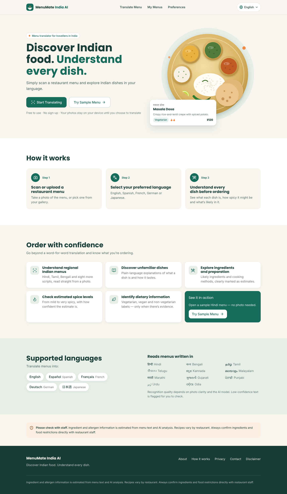

# MenuMate India AI

**Discover Indian food. Understand every dish.**

A mobile-first web app that helps international tourists understand restaurant menus written in Indian regional languages. Photograph a menu, choose a language, and see every dish with its original name, a translation, a tourist-friendly explanation, an estimated spice level, dietary information and potential allergens, each labelled with a confidence level.



---

## What works

| Feature | Without API key | With `GEMINI_API_KEY` and/or `GROQ_API_KEY` |
|---|---|---|
| Landing page, navigation, footer pages | ✅ | ✅ |
| Sample menu demo (6 dishes, 5 languages) | ✅ | ✅ |
| Search (original + translated names), category/diet filters, sorting | ✅ | ✅ |
| Dish details, “Explain this dish” | ✅ demo data | ✅ live AI, cached |
| Favourites, saved menus, preferences (localStorage) | ✅ | ✅ |
| Preference highlighting and up to 3 suggestions | ✅ rule-based | ✅ AI, restricted to menu items |
| Photo upload, camera, drag-and-drop, validation, preview | ✅ | ✅ |
| Menu OCR, language detection, translation | ❌ clear setup message | ✅ |
| Re-translate a saved menu into another language | ❌ | ✅ (no photo needed) |

Without a key the app never pretends to translate: the Translate button is disabled with an explanation, and the sample menu is offered instead.

---

## Project structure

```
menumate-india-ai/
├── api/                    Vercel serverless functions (one file per endpoint)
│   ├── health.ts           GET  → { configured, model } (never the key)
│   ├── extract.ts          POST → Operation 1: OCR + language detection
│   ├── translate.ts        POST → Operations 2+3: translation + dish intelligence
│   ├── explain.ts          POST → "Explain this dish"
│   └── recommend.ts        POST → Operation 4: up to 3 suggestions
├── server/
│   ├── handlers.ts         Platform-neutral handlers + input validation
│   ├── ai.ts               Provider chain: Gemini first, Groq automatic backup
│   ├── gemini.ts           Google Gemini provider
│   ├── groq.ts             Groq provider (OpenAI-compatible, vision)
│   ├── errors.ts           Shared error types, retry-time parsing
│   ├── prompts.ts          Prompts for each AI operation
│   └── http.ts             Request/Response adapter
├── src/
│   ├── lib/
│   │   ├── types.ts        Data model
│   │   ├── validate.ts     AI output validation (shared by server and browser)
│   │   ├── matching.ts     Preference matching + rule-based suggestions
│   │   ├── pipeline.ts     Translation workflow with real per-stage status
│   │   ├── api.ts          Browser API client (same-origin /api only)
│   │   ├── image.ts        File validation, resize/compress, thumbnails
│   │   ├── storage.ts      localStorage persistence (fault-tolerant)
│   │   └── languages.ts    Source/target languages (extend here)
│   ├── state/              App store (React context) + hash router
│   ├── components/         Header, Footer, BottomNavigation, UploadArea, ImagePreview,
│   │                       LanguageSelector, ProcessingStatus, MenuItemCard, DishDetails,
│   │                       SearchBar, CategoryFilter, DietaryFilter, SpiceIndicator,
│   │                       FavouriteButton, PreferenceSettings, SavedMenuCard,
│   │                       ErrorMessage, ConfirmationModal, Recommendations, Illustrations
│   ├── screens/            Home, Upload, Language, Processing, Menu, Preferences, Saved, Info
│   ├── data/               Sample menu (demonstration data) + illustrative menu image
│   └── index.css           Tailwind v4 theme (design tokens)
├── tests/                  Unit + backend tests (mocked Gemini, no key needed)
├── docs/                   Testing checklist, screenshots
├── vite.config.mts         Vite + local /api dev server
└── vercel.json
```

Some components named in the brief live together in one file (for example `SpiceIndicator` and `FavouriteButton` are exported from `MenuItemCard.tsx`; `UploadArea` and `ImagePreview` from `UploadScreen.tsx`).

**Stack:** React 19, TypeScript, Tailwind CSS v4, Lucide icons, Vite, Vercel serverless functions, Google Gemini API with Groq as automatic backup, browser localStorage. Total cost: ₹0 on free tiers.

---

## Setup (local)

Requirements: Node.js 20+.

```bash
npm install
cp .env.example .env.local      # then paste your key(s) into .env.local
npm run dev                     # http://localhost:5173
```

`npm run dev` serves the frontend **and** the `/api/*` endpoints (via a small Vite plugin in `vite.config.mts`), so you don’t need the Vercel CLI locally.

Other scripts:

```bash
npm test          # 38 unit/backend tests (no API key or network needed)
npm run typecheck
npm run build     # production build into dist/
```

## Environment variables

| Name | Required | Where | Purpose |
|---|---|---|---|
| `GEMINI_API_KEY` | At least one of the two keys | Server only | Google AI Studio API key (primary) |
| `GEMINI_MODEL` | No | Server only | Defaults to `gemini-3.8-flash` |
| `GROQ_API_KEY` | At least one of the two keys | Server only | Groq API key (automatic backup) |
| `GROQ_MODEL` | No | Server only | Defaults to `qwen/qwen3.8-27b` (must support image input) |
| `AI_PROVIDER_ORDER` | No | Server only | `gemini,groq` (default) or `groq,gemini` |

> ⚠️ **Never prefix any of these with `VITE_`.** Vite bundles any `VITE_*` variable into browser JavaScript. The key is only ever read by `server/` code; the browser calls same-origin `/api/*` and the key is sent to Google in the `x-goog-api-key` header from the server. `/api/health` reports only whether a key exists.

## Gemini API setup

1. Go to [Google AI Studio](https://aistudio.google.com/apikey) and create an API key (free tier, no card needed in most regions).
2. Put it in `.env.local` (local) or your host’s environment settings (production) as `GEMINI_API_KEY`.
3. Optional: set `GEMINI_MODEL`. Any current Gemini model that accepts image input and JSON output works. Check the [models page](https://ai.google.dev/gemini-api/docs/models) and your AI Studio rate limits — model names and free-tier quotas change over time. If the model name is wrong, the app shows “not configured” instead of failing silently.
4. Open the app, upload a menu, and translate. The language screen shows “Live AI translation is available (model)” when the server is configured.

**Free-tier note:** on Google’s free tier, submitted content may be used to improve Google’s products. The Privacy page says this to users. For production with real users, consider a paid tier.

## Groq backup setup (recommended)

Free AI tiers run out or get busy. With a Groq key added, the server automatically sends the same request to Groq whenever Gemini is overloaded (503), out of quota (429), misconfigured or returns unusable output. Users don't see an error unless both fail.

1. Go to [console.groq.com](https://console.groq.com) and sign in (Google or GitHub, no card needed).
2. Open **API Keys → Create API Key**, name it `menumate`, and copy it (it is shown once).
3. Add `GROQ_API_KEY=...` to `.env.local` (and to Vercel later). Restart `npm run dev`.
4. The language screen should show *“Live AI translation is available (gemini-3.8-flash + backup qwen/qwen3.8-27b)”*.
5. Check your actual free limits at [console.groq.com/settings/limits](https://console.groq.com/settings/limits). If the default model is retired, pick a current vision model from [the Groq vision docs](https://console.groq.com/docs/vision) and set `GROQ_MODEL`.

How the chain behaves:
- **Gemini busy or out of quota:** the request goes straight to Groq, with no wasted Gemini retry.
- **Unusable JSON:** retried once on the same provider, then the next provider is tried.
- **Every request stays under 55 s:** Gemini gets at most 35 s when a backup exists, so the 60 s serverless limit isn't exceeded.
- **Per-minute limits** (e.g. Groq's tokens-per-minute cap): the browser shows a real countdown (“Free AI limit reached — continuing in 8s”) and carries on automatically. It waits up to 3 minutes per pause and up to 8 pauses per request, a little longer each time.
- **Daily limit reached:** the menu read from the photo is already saved, so nothing is lost. Any dish can be explained later from its card.
- **Daily-quota provider skipped until reset:** when a provider's daily quota is used up, the server skips it until its reset time instead of asking it first every time.
- **Output tokens sized per request:** each request asks only for the output tokens it needs (about 300 per dish), which leaves more of Groq's per-minute budget free.
- **Both out of daily quota:** the user sees when the soonest reset is.
- **Which provider was used:** shown on each translated menu as “Read by Gemini: …” or “Read by Groq: …”. The terminal or Vercel logs show `[ai] Gemini failed (DAILY_QUOTA); switching to Groq`.

Translation is sent in batches of 10 dishes to stay under free per-minute token limits.

## Deployment (Vercel, free Hobby plan)

1. Push this folder to a GitHub repository.
2. In Vercel: **Add New → Project → Import** the repository. The framework is detected as Vite (`vercel.json` also sets it).
3. **Settings → Environment Variables**: add `GEMINI_API_KEY` and `GROQ_API_KEY` (and optionally `GEMINI_MODEL` / `GROQ_MODEL`) for Production and Preview.
4. Deploy. Files in `api/` become serverless functions at `/api/*`; `vercel.json` allows up to 60 seconds per call, which long menus need.
5. Open `https://<your-app>.vercel.app/api/health`. It should return `{"ok":true,"configured":true,...}`.

**Other hosts:** `server/handlers.ts` is platform-neutral (plain JSON in, `{status, body}` out). To use Netlify or Cloudflare, write a 5-line adapter like `server/http.ts`. Keep in mind that Netlify’s default synchronous function timeout (10s) is too short for OCR on large menus.

---

## How the AI workflow works

**Dishes are explained on tap.** To keep free AI quotas from running out:

1. **Read the menu** (1 request): OCR, language detection, prices, and each dish's pronunciation in Latin letters (e.g. “Masala Dosa”), so tourists can recognise dishes in scripts they can't read.
2. **Dish list opens straight away:** every dish is shown with its pronunciation, original script, price and a **Translate this dish** button. Search works on both scripts.
3. **Tap a dish to explain it** (1 small request): translation, description, spice, dietary info and allergens. Its details open automatically. If a per-minute limit is hit, the button shows a countdown and retries on its own. If a daily limit is hit, the error stays on that card and nothing else is lost.
4. **Other language** re-translates only the dishes already explained. **Suggest dishes** appears once 2 or more dishes are explained, and only considers explained dishes.

The rest of this section describes the request pipeline underneath.

```
Photo ──(resize ≤1600px, JPEG, in browser)──► /api/extract ──► validate ──► [language unsure? ask user]
                     (Gemini → Groq backup)                          │
                                                     dish list opens (saved)
                                                                     │
                     /api/translate (one dish, when tapped) ◄────────┘
                                │
                     validate + merge ──► saved menu (localStorage)
```

- **Real progress only.** Each of the six stages is marked done only when its operation has finished. Detection and extraction come back from one AI call, as do translation and explanations, so those pairs complete together. The screen says so instead of faking separate progress. Elapsed time is shown, and there are no fake percentages.
- **Prices are extracted once and locked.** The translate endpoint never returns prices, and the browser merges translations by item id, keeping the extracted price. Unreadable or ambiguous prices (for example “90 / 160”) stay `null` and appear as “Price not readable”.
- **Validation on both sides.** `src/lib/validate.ts` runs on the server and again in the browser. It handles malformed JSON (one automatic retry), unknown enum values, missing items (shown untranslated, all estimates “Unknown”), invented items (dropped), absurd prices, and unsupported safety claims (“allergen-free”, “safe for allergies” are removed).
- **Dietary cross-checks.** A “Vegetarian” or “Vegan” label is downgraded to “Unknown” if the dish name or ingredients mention meat, fish or egg. “Vegan” is downgraded to “Vegetarian” if dairy, ghee or honey is listed. Vegan is never inferred from vegetarian.
- **Retry and fallback.** Failures switch to the backup provider. Malformed output is retried once per provider, and short per-minute limits trigger an automatic countdown. After that, the user gets a Retry button that resumes from the failed stage, so an expensive OCR call is never repeated. Rate limits and bad keys are not retried in a loop.
- **Uncertain language.** If detection confidence is low and the user didn’t choose a language, the workflow pauses and asks. The extracted text is reused, so the image is not sent again.

---

## Data & privacy

- No accounts. All persistence is browser localStorage: `menumate.prefs.v1`, `menumate.menus.v1`, `menumate.favourites.v1`, `menumate.lastMenu.v1`.
- Images are held in memory as object URLs and sent only when the user taps **Translate Menu**. Only a ~240px JPEG thumbnail (~10 KB) is saved. Up to 20 menus are kept. If storage is full, thumbnails are dropped first, and the user is told if saving fails.
- Users can delete individual menus, all menus, favourites and preferences (each with confirmation).

## Accessibility

Semantic landmarks, skip link, labelled inputs, `aria-pressed` toggles, `aria-live` status for progress, results counts and toasts, modal focus trap with Escape and focus return, 44px+ touch targets, visible focus rings, `prefers-reduced-motion` support, and `lang` attributes on original-script text so screen readers pronounce it correctly. Colour note: the brief’s secondary text colour `#747474` passes WCAG AA for body text on white (4.6:1) but not on the cream background (≈4.2:1), so on cream the app uses ink at reduced opacity instead. Text on the orange accent uses ink, not white, for contrast.

---

## Known limitations

- **Live AI calls haven’t been run end-to-end by the developer build.** This build had no API keys or outbound network access. The Gemini integration follows the current REST docs (`generateContent`, inline image data, `responseMimeType: application/json`). The Groq integration follows Groq’s vision docs (`image_url` data URLs, `response_format: json_object`). Both are covered by tests against mocked APIs.
- **Free tiers are never error-free.** The Groq backup makes errors much rarer, but if both providers are out of quota at once, users see a clear message (and the sample menu still works). Groq’s published limits are base limits; check your account’s limits page.
- **Reading quality differs by provider.** Open models on Groq may misread some regional scripts (e.g. Odia, Malayalam) more often than Gemini. Uncertain lines are still flagged for review, and prices are never guessed. The full browser flow was tested against a mocked `/api`. Run one real menu after adding your key, and adjust `GEMINI_MODEL` if needed.
- **Vercel deployment not exercised here.** The `api/*.ts` files use Vercel’s Web-standard `GET`/`POST` exports. Check `/api/health` after your first deploy.
- **OCR quality depends on the photo and the model.** Handwritten menus, stylised fonts, glare and multi-column layouts reduce accuracy. Low-confidence lines are flagged, not hidden.
- **Interface text is English.** Menu content is translated into the five target languages; the app chrome isn’t localised yet. Sample-menu detail notes (ingredients, explanations) are English-only, and the UI says so.
- **Food images are illustrations**, not photography. Licensed food photography can replace `src/components/Illustrations.tsx`. Generating per-dish photos would risk showing a dish that doesn’t match the restaurant’s.
- **Indic fonts:** Devanagari loads from Google Fonts. Other scripts rely on the device’s system fonts, which all modern phones include.
- **HEIC photos** (iPhone default in some settings) are not supported by most browsers’ image decoders. Users see a clear message asking for JPG/PNG. iOS Safari usually converts to JPEG automatically when using the file picker.
- **Safety-claim filtering is English-pattern based.** Prompts forbid such claims in every language, and the UI always shows the staff-confirmation warning, but the regex backstop only catches English phrasing.
- **localStorage only.** Data doesn’t sync across devices. Supabase (or similar) could add optional accounts later without changing the data model.
- **No rate limiting on `/api/*`.** For a public deployment, add per-IP limits (for example Vercel Firewall rules or Upstash) to protect your free Gemini quota.

See [docs/TESTING.md](docs/TESTING.md) for the testing checklist and results.
